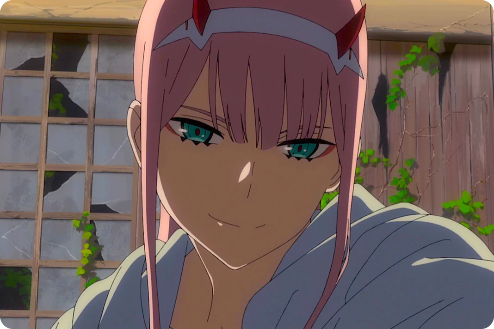

<!-- Typing header: edit the lines= part of the URL (use + for spaces, ; between lines) -->

  

<!-- Profile video: upload assets/profile-video.mp4 by dragging it into this README editor.
     Replace the placeholder URL below with the GitHub user-attachments URL GitHub generates. -->

  <video
    src="https://github.com/user-attachments/assets/020f9e2d-0996-4b50-8379-af25382e7e60"
    controls
    width="670">
  </video>

<!-- 800px grid: row 1 = 534 + 10 + 256 (both 356px tall). Row 2 = 414 + 10 + 112 + 10 + 254 (all 148px tall). -->
<!-- Spotify uses the default theme (320x445 scaled to 256x356). -->

<!-- YouTube: left out for now. Later, make a second button like link-projects.svg, set both buttons to height 69 and stack them. -->

  
  <picture>
    <source media="(prefers-color-scheme: dark)" srcset="https://raw.githubusercontent.com/pham-02/pham-02/output/github-snake-dark.svg">
    
  </picture>

