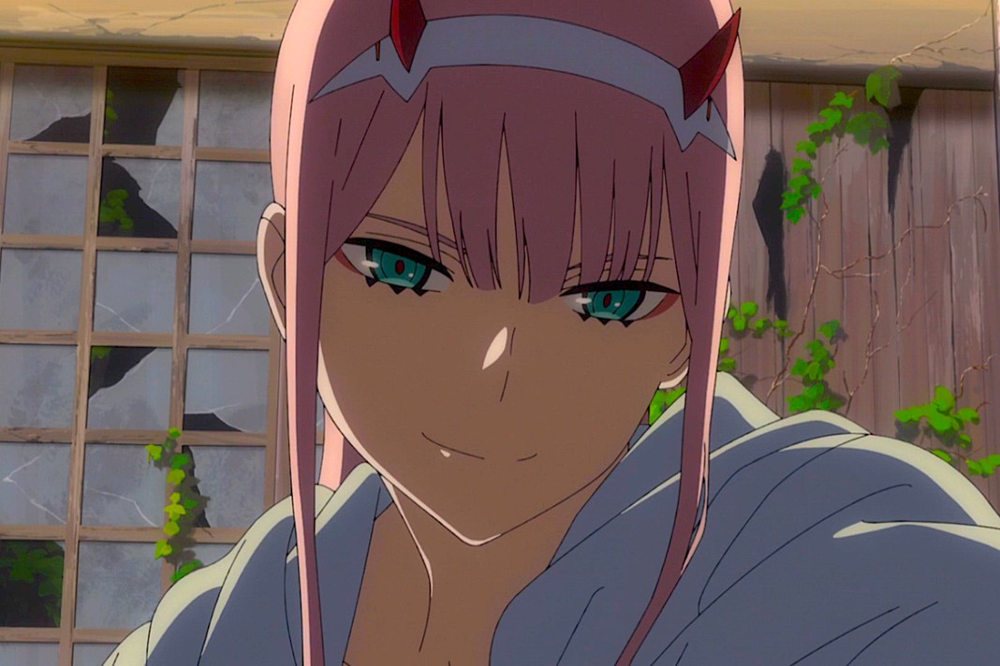
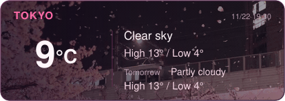
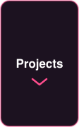
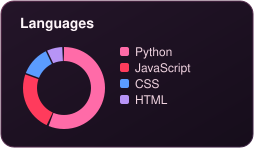

<!-- Typing header: edit the lines= part of the URL (use + for spaces, ; between lines) -->

  

<!-- Photo (534px) + Spotify (256px). -->
<!-- Spotify uses the default theme (320x445, scaled to 256x356). Delete &bar_color / &background_color from the URL for the stock green look. -->

  
  
  

<!-- Weather (414) + Projects (112) + Languages (254), 10px gaps = 800 total -->

  
  
  
  
  

<!-- YouTube: left out for now. When you have a channel, make a second button
     (copy assets/link-projects.svg, change the text, set height to 85) and
     shrink Projects to height 85 too, then stack them in the middle column. -->

  <picture>
    <source media="(prefers-color-scheme: dark)" srcset="https://raw.githubusercontent.com/pham-02/pham-02/output/github-snake-dark.svg">
    
  </picture>

